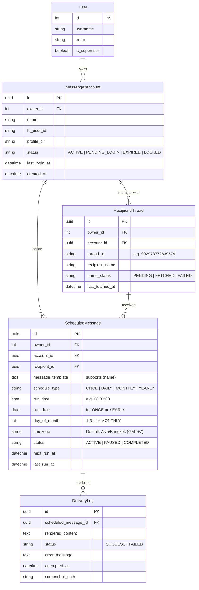

# Facebook Messenger Automation System — Design Specification

- **Date**: 2026-11-17
- **Author**: Antigravity & devtrung
- **Status**: Validated Design

---

## 1. Overview & Objectives

The goal of this project is to build an automated Facebook Messenger messaging platform using Python, Camoufox (anti-detect browser), Django, and PostgreSQL. The system allows administrators to schedule one-off (e.g., New Year, birthdays) and recurring messages (daily, monthly, yearly) to specific recipients in GMT+7 (`Asia/Bangkok`), with dynamic placeholders like `{name}`.

### Core Capabilities
1. **Admin & Access Control**: Private per-admin ownership of accounts, threads, and schedules, with superuser oversight.
2. **Interactive Browser Login via WebSocket**: Real-time canvas streaming of a Camoufox instance over Django Channels, with mouse, keyboard, and `Ctrl+V` clipboard paste support, plus automatic `c_user` cookie detection and profile persistence.
3. **Recipient Management & Name Resolution**: Thread ID ingestion (e.g., `902973772639579` from `https://www.facebook.com/messages/t/902973772639579`) with automated name extraction from Messenger DOM.
4. **Name-Centric Task Scheduling**: Scheduling interface allowing selection of recipients by their fetched human-readable name (with thread ID disambiguation).
5. **Background Automation Engine**: Celery + Celery-Beat powered execution in GMT+7 with retry policies and audit logging.

---

## 2. Technology Stack & Environment

- **Language & Package Management**: Python 3.12+ managed via `uv` (`pyproject.toml`).
- **Nix & Devenv**: `devenv.nix` providing native runtime dependencies required by Camoufox / Firefox (GTK3, NSS, NSPR, Cairo, Pango, libdrm, X11, Mesa, FFmpeg) with pre-configured `LD_LIBRARY_PATH`.
- **Web Framework & Realtime**: Django 5.x with Django Channels running under ASGI (`daphne`).
- **Database**: PostgreSQL with Django ORM.
- **Task Queue & Scheduler**: Celery 5.x + Celery-Beat with Redis message broker.
- **Browser Automation**: `camoufox[geoip]` with persistent browser profiles stored per account.

---

## 3. Data Models & Relationships

---

## 4. Subsystem Details

### 4.1 Interactive WebSocket Screencast & Login Detection
- **WebSocket Route**: `/ws/accounts/<uuid:account_id>/stream/`
- **Session Lifecycle**:
  1. Admin opens the "Add/Connect Account" modal.
  2. The Django Channels consumer spawns a persistent Camoufox browser context pointed to `data/profiles/<account_id>`.
  3. Browser navigates to `https://www.facebook.com/login` (`wait_until="domcontentloaded"`).
  4. Frame Streaming:
     - **Adaptive Diffing**: Frame updates are triggered on user interaction (clicks, typing, scroll). While idle, a periodic capture runs at ~1 FPS and transmits only if the image MD5 buffer changes.
     - Frames are sent as binary JPEG data to an HTML5 `<canvas>`.
  5. Input Handling:
     - Mouse clicks and pointer movements scaled to 1280x800 viewport.
     - Keypress events forwarded to `page.keyboard.down()` / `up()`.
     - **Clipboard & Ctrl+V**: Canvas intercepts `paste` events, extracts `event.clipboardData.getData('text')`, and sends `{type: "paste", text: ...}` over WebSocket. The backend inserts text via `page.keyboard.insert_text(text)`.
  6. Login Completion:
     - Background watcher inspects `context.cookies()` every 1.5s for `c_user` (and `xs`).
     - Once `c_user` is present, it extracts the Facebook User ID, sets account status to `ACTIVE`, and notifies client `{type: "login_success", fb_user_id: ...}`.
     - The UI also provides a manual "Done / Save Account" button as a fallback.
     - Clean exit: context is closed to flush sqlite cookies and profile state to disk.

### 4.2 Recipient Thread & Name Resolution
- **Thread Ingestion**: Admin enters a raw Thread ID (`902973772639579`) or paste full URL (`https://www.facebook.com/messages/t/902973772639579`).
- **Automated Name Extraction**:
  - Background task launches headless Camoufox with the assigned account profile.
  - Navigates to thread URL with `domcontentloaded`.
  - Extracts recipient/conversation name from verified DOM targets:
    - `div[role="textbox"][aria-label^="Write to "]` (strips "Write to " prefix).
    - `div[aria-label^="Conversation titled "]` (strips "Conversation titled " prefix).
  - Updates `RecipientThread.recipient_name` and sets `name_status = 'FETCHED'`.

### 4.3 Scheduling & Message Dispatching
- **Recipient Selection in UI**:
  - When scheduling a message, the recipient dropdown shows the **Recipient's Name** first (e.g. `Hồ Bách`).
  - If multiple threads have the same name or for clarity, the Thread ID is displayed alongside: `Hồ Bách (Thread: 902973772639579)`.
- **Timezone & Recurrence (GMT+7)**:
  - Input schedule times are entered in `Asia/Bangkok`.
  - `next_run_at` is indexed in UTC.
  - Supported recurrences:
    - `ONCE`: Runs at specific date and time, transitions to `COMPLETED`.
    - `DAILY`: Runs daily at specified time, advances next run by 1 day.
    - `MONTHLY`: Runs on specific day of month (clamps to last day if month has fewer days, e.g. Feb 28/29).
    - `YEARLY`: Runs annually (e.g. Jan 1 at 00:00:00 for New Year, or birthdays).
- **Execution Pipeline**:
  1. Celery-Beat triggers `send_due_messages` every minute.
  2. Dispatches Celery task `dispatch_scheduled_message.delay(schedule_id)`.
  3. Worker launches headless Camoufox with the account profile.
  4. Opens `https://www.facebook.com/messages/t/<thread_id>`.
  5. Interpolates `{name}` placeholder into message template.
  6. Focuses `div[role="textbox"]`, types message text, and presses `Enter`.
  7. Waits 2s for sent state, records `DeliveryLog` (with screenshot on failure), and calculates next recurrence timestamp.

---

## 5. Web UI Structure

1. **Dashboard (`/`)**: High-level statistics (Active accounts, total threads, pending scheduled messages, 24h delivery history).
2. **Accounts (`/accounts/`)**: List accounts, account status, link to real-time WebSocket login stream.
3. **Recipients (`/threads/`)**: Add thread ID, trigger name refresh, view participant names.
4. **Schedules (`/schedules/`)**: Create and manage schedules with recipient name dropdown, template preview, and recurrence rules.
5. **Logs (`/logs/`)**: Audit history of sent messages, delivery status, and debug screenshots.

---

## 6. Verification & Testing Plan

1. **Unit Tests**:
   - `test_recurrence.py`: Verification of GMT+7 to UTC conversions across daily, monthly, and leap-year schedules.
   - `test_templates.py`: Validation of `{name}` tag rendering and fallback handling.
2. **WebSocket & Streaming Tests**:
   - `test_stream_consumer.py`: Consumer connection, input event serialization, and clipboard paste insertion.
3. **End-to-End Automation Verification**:
   - Headless Camoufox integration test against saved test profile verifying DOM selector resolution for recipient names and message input fields.
